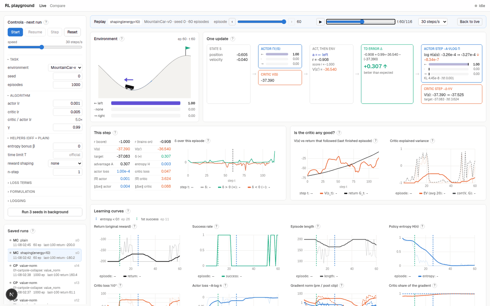
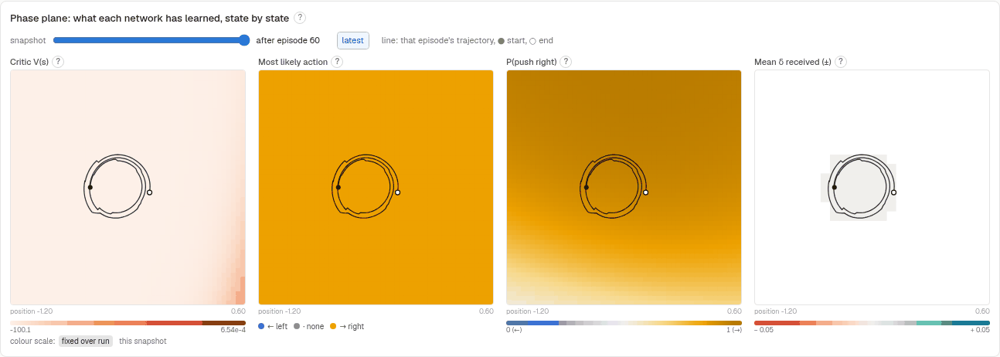
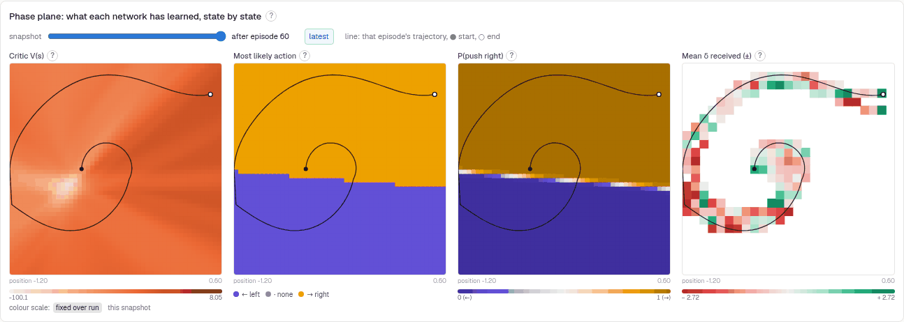
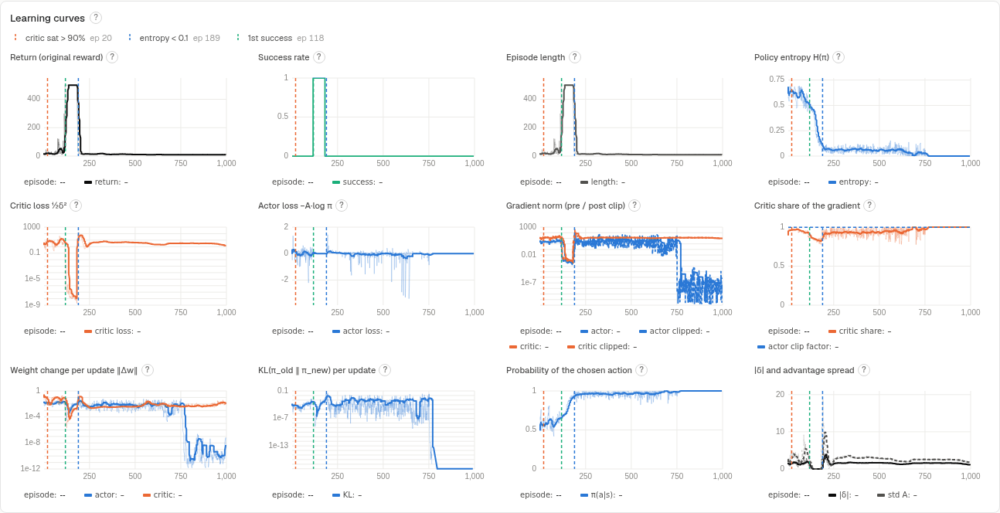
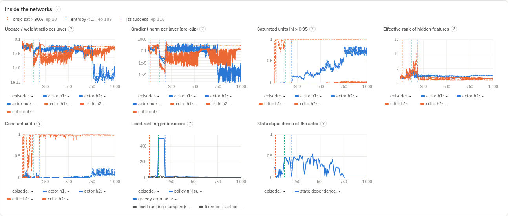

# Deep RL playground

A small research playground for **seeing** how actor-critic learns: which part is learning, what it learns, and why it fails. The first algorithm is plain one-step actor-critic (Sutton & Barto, ch. 13.5) on Gymnasium's **MountainCar-v0**, with **CartPole-v1** as a known-answer check. A Next.js dashboard shows training live: the car, the agent's choices, and every learning signal.



## Quick start

You need Python ≥ 3.11 with [uv](https://docs.astral.sh/uv/), and Node ≥ 20 with npm. Everything runs locally on the CPU. Open two terminals in the project folder:

```bash
# terminal 1: backend (training + API on :8000)
cd backend && uv sync && uv run uvicorn server:app --reload --port 8000

# terminal 2: frontend (dashboard on :3000)
cd frontend && npm install && npm run dev
```

Then open **http://localhost:3000**. On WSL, open it in the Windows browser; WSL forwards localhost.

A good first session:

1. **CartPole, plain**, with actor lr 5e-4 and critic lr 2.5e-3. It learns to balance within about 200 episodes, then collapses. This confirms the code works, and the collapse is the first lesson.
2. **MountainCar, plain** (all defaults). It never reaches the flag. Watch V(s) settle at −100 and δ go to 0 (see *What to expect*).
3. **MountainCar + reward shaping (energy).** The phase-plane maps show the spiral: push in the direction you are moving, swing higher, reach the flag.
4. Then change **one switch at a time**. *Run 3 seeds in background* trains the current setup with 3 seeds; open the **Compare** page to overlay setups.

## What to expect

### MountainCar-v0, plain: it does not learn, and that is correct behaviour

- The reward is −1 on every step, and the flag is almost never reached by chance within 200 steps.
- A policy that never reaches it has the same true value in every state: **V\* = −1/(1−γ) = −100** (γ = 0.99, bootstrapping at the time limit).
- The critic learns exactly that. Then δ = −1 + 0.99·(−100) − (−100) = 0 everywhere, and the actor gets no signal.
- **The critic is right, and that is why nothing learns.** The dashboard marks this as *no signal: V≈V\*, δ≈0* and draws V\* on the V chart.
- A side effect worth seeing: with Adam, the actor still moves (‖Δw‖ ≈ 1e-4 at δ ≈ 1e-5), because Adam divides by its running gradient size. After 60 episodes the policy has drifted to "push right" almost everywhere: a state-independent policy produced from zero signal.

| Plain: no signal (flat V = −100, gray δ, one action everywhere) | Energy shaping: the spiral (policy splits at velocity 0) |
|---|---|
|  |  |

What fixes it is a change to the *problem formulation*. [Experiment 02](docs/experiments/02-mountaincar-formulation.md), 5 seeds, 500 episodes:

- **Potential-based shaping** (energy) is the only setup that learns: 5/5 seeds reach the flag, and 3/5 succeed in ≥ 88% of the last 100 episodes.
- **n-step/GAE** and the **entropy bonus** stay at V = −100 and δ ≈ 0 (0/5): they cannot spread a reward that never arrives.
- **The time-limit bug** produces exactly its computed artefact: V ≈ −67, δ ≈ −0.33 on ordinary steps and **+68 on the last step** of every episode.
- **Plain** ends with a fully deterministic policy (entropy ≈ 1e-5) built from noise alone. With the entropy bonus and the same δ ≈ 0, the policy stays exactly uniform (H = ln 3). That is the bonus at work: it is the only force left to oppose the Adam drift.
- **Shaping only helps while the car moves.** One shaped seed settled at the bottom doing nothing, where Φ barely changes, so δ ≈ 0 again.

### CartPole-v1: learns, then collapses

| Learning rates | Seeds | Learns? | After learning |
|---|---|---|---|
| defaults (actor 1e-3, critic 5e-3) | 0–2 | best 100-episode moving average 300–360 by episode ~200 | collapses to ~9 |
| actor 5e-4, critic 2.5e-3, chosen on seeds 0–1 | 0–2 | MA > 400 by episodes 195–240 | **every seed collapses later** (final MA 9.4–9.9) |
| same, on held-out seeds | 10–12 | 2 of 3 pass (episodes 166, 168); seed 10 never learns | all three collapse |

Lower learning rates **delay** the collapse; they do not fix it. The check (`scripts/check_cartpole.py`) passes by its rule, best MA > 400 on ≥ 2/3 seeds, which shows the code can learn. The collapse is a property of the algorithm and settings, not a bug. Exact-value tests (below) cover correctness without any learning noise.



What a collapsing run shows, in order:
1. The critic's last hidden layer saturates (more than 90% of tanh units beyond ±0.95), so V is flat and δ is mostly noise.
2. Adam turns that noise into full-size steps.
3. Entropy runs to 0 and π(a|s) to 1. At p ≈ 1, ∇log π ≈ 0, so the policy cannot recover.
4. Finally the actor ignores the state: the fixed-ranking probe scores the same as the policy.



**But order is not causation.** [Experiment 01](docs/experiments/01-cartpole-collapse.md) removed the saturation (value_norm, reward ×0.01) and the policy still collapsed. Only the entropy bonus let returns recover.

## The algorithm

Two separate networks, each with 2 hidden layers of 64 tanh units: the actor π_θ(a|s) (softmax) and the critic V_w(s). Both use Adam (actor lr 1e-3, critic 5e-3) and γ = 0.99. Both are updated **at every environment step**, with no replay buffer, batches, target network or clipping:

```
δ   = r + γ · V(s') · (1 − terminated) − V(s)          TD error
L_V = ½ δ²                  V(s') is a constant (semi-gradient TD)
L_π = −δ.detach() · log π(a|s)      δ > 0: make a more likely, δ < 0: less likely
```

- **terminated** (goal reached, pole fell): s' is a real terminal state with value 0, so we do not bootstrap.
- **truncated** (the time limit): the episode was cut off, but s' still has a future, so we **do** bootstrap from V(s'). Treating truncation as termination is a classic bug. It is available as a switch, to see what it does.

Observations are scaled to [−1, 1] (MountainCar position [−1.2, 0.6], velocity [−0.07, 0.07]). Seeds fix torch, numpy and the environment. Each process uses one thread, so the same seed and settings give the same curves bit for bit.

Code: `backend/rl/actor_critic.py` (the update, with the equations in the comments), `trainer.py` (the loop, the n-step window and the measurements), `envs.py`, `networks.py`.

## Switches

Every switch is **off by default**, so the default run is the plain algorithm. A run is labelled `plain`, or with the switches it used (e.g. `entropy β=0.01 · n=5`).

| Group | Switch | What it changes | Where to look |
|---|---|---|---|
| Helpers | entropy bonus β | actor loss −= β·H(π) | entropy curve; does π still explore? |
| | time limit T | episode length (official: 200 MC, 500 CP) | length, success |
| | reward shaping (energy / height) | F = γΦ(s') − Φ(s), Φ(terminal) = 0. Keeps the optimal policy (Ng et al. 1999). Scores always use the original reward | δ map, phase maps |
| | n-step | n-step returns; at an episode end the window shrinks, nothing crosses episodes | \|δ\| and advantage spread |
| Loss terms | GAE λ | truncated GAE over the n-step window (λ=1: n-step, n=1: one-step) | bias/variance: advantage spread vs curves |
| | gradient clip: per network / joint | joint = one norm over both networks, as in PPO code with a shared optimiser | critic share of the gradient, clip factor, pre/post-clip norms |
| | advantage norm | running EMA mean/std (online updates have no batch) | actor step size |
| | lr schedule: linear / cosine → 0 | | ‖Δw‖ and update/weight ratio shrinking |
| | optimizer: SGD | step = lr·gradient, so δ ≈ 0 gives no step. Needs 10–100× larger LRs | ‖Δw‖ vs gradient norm |
| | I = γᵗ on the actor | Sutton & Barto's discount on the actor step | late-episode learning |
| | value norm | critic regresses target/σ, σ = running RMS of targets; the output layer is rescaled when σ moves, so V does not jump (PopArt-style) | critic saturation |
| | Adam ε | step = lr·m/(√v + ε): a larger ε stops tiny gradients from getting full-size steps | optimizer amplification ‖Δw‖/(lr·‖∇‖) |
| | actor optimizer | SGD or Adam for the actor only | amplification, entropy |
| | reward scale | training reward ×k (scores unchanged) | critic saturation, V scale |
| Formulation | observation: raw / scaled / RBF | raw inputs push tanh units into saturation | saturated units, effective rank |
| | time-left input | makes the time limit Markov | V(s) vs return |
| | bootstrap at time limit (off = bug) | treats the time limit as terminal | δ spike at t = T, V vs return |
| | actions: 2 (MC) | drop "do nothing" | action map |
| | network: sizes, tanh / ReLU | | dead/saturated units |

## What each view shows

Every panel has a **?** with a one-sentence explanation. In short:

- **Environment.** The state the agent acted in, the action (arrow), and the actor's probability for each action.
- **One update.** One step of learning, left to right: π(·|s) and V(s), then a, then r and s', then V(s'), then δ (with the actual numbers), then the actor step (log π before → after, the probabilities moving) and the critic step (V before → after, the target). It animates when steps are slow enough to follow.
- **This step.** All numbers of the step, and δ over the episode.
- **Is the critic any good?** V(s_t) against the discounted return that actually followed, and the critic's explained variance per episode. A teacher that is wrong makes δ noise.
- **Learning curves.** Return, success rate, length, entropy, losses, gradient norms (pre/post clip), the critic's share of the gradient, ‖Δw‖ per update, KL per update, π(a|s), |δ| and advantage spread. Dashed lines mark events: critic saturation > 90% and entropy < 0.1 (CartPole), *no signal* (MountainCar), first success.
- **Phase plane.** Maps over (position, velocity) of V(s), the most likely action, P(push right) and the mean δ received, with that episode's trajectory. A slider walks through the snapshots taken every K episodes. Colour scales are honest: V uses one scale over the whole run, and δ has a floor tied to the reward scale, so noise renders gray.
- **Inside the networks.** Per layer: update/weight ratio and gradient norm. Per hidden layer: saturated (or dead) units, constant units, effective rank. The **fixed-ranking probe**: every K episodes the policy is replaced by one state-independent ranking (the mean logits) and scored. If that scores as well as the real policy, the actor ignores the state.
- **Compare page.** Overlay setups (runs that differ only in seed): the line is the mean over seeds and the band is min–max. The mean turns dotted when a seed has ended, so it never silently averages only the survivors. Also: a table of switches, and the episode order of "critic saturates" vs "entropy collapses" for every run.

## Runs, replay, compare

Every run is saved in `runs/<run_id>/`:

- `config.json`: the config, label and `config_key` (a hash of the config without the seed)
- `metrics.jsonl`: one JSON record per line: `step`, `episode`, `snapshot`, `probe`, `diverged`, `run_end`
- `summary.json`
- `checkpoints/epNNNNN.pt`

Click a run under **Saved runs** to replay it without training again: curves, maps, and any logged episode step by step. `/?run=<id>&ep=<n>` opens one directly.

Headless ablations:

```bash
cd backend
uv run python scripts/run_batch.py --env CartPole-v1 --seeds 0 1 2 --set actor_lr=5e-4 critic_lr=2.5e-3 value_norm=true
uv run python scripts/experiments.py run 01-cartpole-collapse     # pre-registered experiments
uv run python scripts/experiments.py analyse 01-cartpole-collapse
```

If values blow up (inf/NaN, e.g. SGD with too large a learning rate), the run is recorded as **diverged** and stops, instead of crashing.

## Checks

```bash
cd backend
uv run pytest                                   # 62 tests, ~1.5 min
uv run python scripts/check_cartpole.py         # known-answer learning check (3 seeds, a few minutes)
uv run python scripts/check_cartpole.py --full --seeds 10 11 12   # all 1000 episodes, held-out seeds
```

The tests cover:
- the TD target for terminated vs truncated;
- the semi-gradient critic;
- the actor-loss sign (log π rises when δ > 0);
- n-step windows at episode ends;
- that shaping telescopes;
- observation scaling;
- seed reproducibility;
- that Adam's step does not shrink with the gradient.

`tests/test_known_values.py` checks values that can be computed by hand:
- a 5-state chain, where the critic must learn Σγʲ within 5%;
- a time-limited loop, where bootstrapping learns 1/(1−γ) and the bug switch underestimates it.

## Experiments

Hypotheses, predictions and decision rules are committed **before** the runs; results are added afterwards.

- [01 · Why does CartPole collapse?](docs/experiments/01-cartpole-collapse.md)
  - Value normalisation removes the critic saturation, but not the collapse.
  - SGD at 20× the LR diverges.
  - The entropy bonus lets returns recover.
- [02 · MountainCar: how the formulation changes what can be learned](docs/experiments/02-mountaincar-formulation.md)
  - Only potential shaping learns.
  - The bootstrap bug's exact TD fixed point (V = −66.9, δ ≈ +66 at the limit) shows up in the logs.
  - A time-left input alone is mostly ignored by the critic.
- [03 · Is the CartPole collapse Adam amplifying a no-signal δ?](docs/experiments/03-cartpole-no-signal-at-success.md) (running)

## Project structure

```
backend/
  rl/config.py          RunConfig: every switch, the label
  rl/envs.py            env factory, observation encoders, potential-based shaping
  rl/networks.py        actor and critic MLPs
  rl/actor_critic.py    the algorithm (no UI code in rl/)
  rl/trainer.py         loop, n-step window, diagnostics, snapshots, probe; emits records
  rl/diagnostics.py     explained variance, effective rank, saturation
  rl/logger.py          runs/<id>/ writer and reader
  server.py             FastAPI: REST control + WebSocket stream
  scripts/              check_cartpole.py, run_batch.py, experiments.py
  tests/                pytest
frontend/               Next.js (App Router, TypeScript, Tailwind, uPlot)
  src/components/       one file per panel; Compare.tsx for /compare
docs/experiments/       pre-registered experiments and their results
runs/                   saved runs (git-ignored)
```
