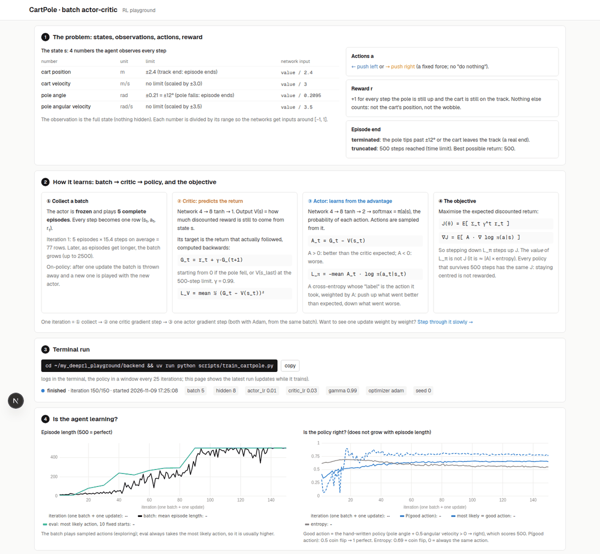

# Deep RL playground

A small playground for understanding how actor-critic learns, by watching it. It currently focuses on **CartPole-v1** with **batch actor-critic** (on-policy, Monte Carlo returns); MountainCar-v0 is next. You train in the terminal and watch the run in the web app.



## Quick start

You need Python ≥ 3.11 with [uv](https://docs.astral.sh/uv/), and Node ≥ 20 with npm. Everything runs locally on the CPU.

**Train (terminal):**
```bash
cd backend && uv sync && uv run python scripts/train_cartpole.py
```
- One log line per iteration in the terminal.
- A window showing the current policy every 25 iterations.
- One plot at the end.
- Everything is saved in `runs/cli/latest/`, replaced by the next run.

**See it (web page)**, in two more terminals:
```bash
cd backend && uv run uvicorn server:app --port 8000
cd frontend && npm install && npm run dev
```
Then open **http://localhost:3000** (on WSL, in the Windows browser). The page refreshes every 2 s while a run is training.

Useful options: `--iters 300`, `--batch 10`, `--actor-lr 0.005`, `--critic-lr 0.05`, `--render-every 0` (no window). `--help` lists them all.

## The web app

- **Run** (`/`): the latest terminal run.
  - The algorithm, status and settings, and a button that copies the train command.
  - Recorded episodes: the policy every 10 iterations, the final one, and a hand-written good policy, replayed with the state values.
  - The environment and the update rule at a glance.
  - Four charts:
    - **Agent**: episode length.
    - **Actor**: is the policy right? P(good action), agreement, entropy.
    - **Critic**: the raw loss.
    - **Critic**: the scale-free error against the true value.
  - The log.
- **Learn** (`/learn`): one update, step by step: collect, critic, returns, advantage, the critic step and the actor step weight by weight.
- **Compare** (`/compare`): overlay saved runs of the experiments.

## The algorithm (batch on-policy actor-critic)

Two networks: actor π(a|s) (4 → 8 tanh → 2 → softmax) and critic V(s) (4 → 8 tanh → 1). Each iteration:

```
1. the frozen actor plays N complete episodes (default 5)  → the batch
2. returns, backwards per episode:  G_t = r_t + γ·G_(t+1)
     ending with 0 if the pole fell (terminated), V(s_T) at the 500-step limit (truncated)
3. advantage:  A_t = G_t − V(s_t)
4. one critic step on   L_V = mean ½ (G_t − V(s_t))²
5. one actor step on    L_π = −mean A_t · log π(a_t|s_t)
6. throw the batch away (on-policy) and repeat
```

The code is `backend/rl/explain.py`. The training script is `backend/scripts/train_cartpole.py`.

Things worth knowing, all visible on the page:
- **The critic loss grows** as episodes get longer, because the returns it predicts get bigger. Judge the critic by its scale-free error instead.
- **The actor loss ≈ |A| × entropy.** Its value is not a quality measure. Judge the actor by P(good action) and the episode length.
- **The reward is +1 per step and nothing else.** Every policy that survives 500 steps scores the same: staying centered is not rewarded. Once almost every episode reaches 500 there is little signal left, and the policy can drift while still scoring 500.

## Other scripts

```bash
cd backend
uv run python scripts/play_cartpole.py          # watch the hand-written good policy in a window
uv run pytest                                   # tests (TD targets, n-step windows, exact known values, …)
uv run python scripts/check_cartpole.py         # known-answer learning check (one-step actor-critic)
uv run python scripts/experiments.py analyse 03-cartpole-no-signal   # pre-registered experiments
```

## Experiments

Hypotheses, predictions and decision rules are committed before the runs; results are added afterwards. These used the one-step (per-step update) actor-critic in `backend/rl/actor_critic.py`.

- [01 · Why does CartPole collapse?](docs/experiments/01-cartpole-collapse.md)
- [02 · MountainCar: how the formulation changes what can be learned](docs/experiments/02-mountaincar-formulation.md)
- [03 · Is the CartPole collapse Adam amplifying a no-signal δ?](docs/experiments/03-cartpole-no-signal-at-success.md)
- [03b · confirmatory (drafted, not run)](docs/experiments/03b-confirm-actor-eps.md)

## Project structure

```
backend/
  rl/explain.py         batch actor-critic, every number of an iteration recorded
  rl/actor_critic.py    one-step actor-critic (used by the experiments)
  rl/trainer.py, envs.py, networks.py, config.py, diagnostics.py, logger.py
  server.py             FastAPI: latest terminal run (/api/cli/latest), Learn page API, older run API
  scripts/              train_cartpole.py, play_cartpole.py, check_cartpole.py, experiments.py, run_batch.py
  tests/                pytest
frontend/               Next.js: / (Run), /learn (one update, step by step), /compare
docs/experiments/       pre-registered experiments and their results
runs/                   saved runs (git-ignored); runs/cli/latest/ = the latest terminal run
```
