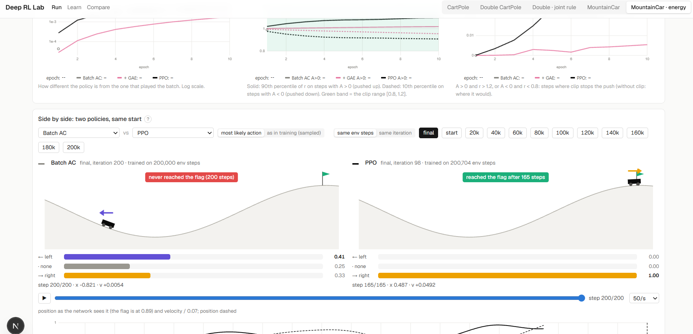

# Deep RL playground

A small playground for understanding how actor-critic learns, by watching it. It currently focuses on **CartPole-v1**: **batch actor-critic** (on-policy, Monte Carlo returns), then **PPO**, built from it one change at a time. MountainCar-v0 is next. You train in the terminal and watch the run in the web app.

**Live site (saved runs, read-only): https://deep-rl-lab.vercel.app**



*Same start, two final policies: batch actor-critic (left) never reaches the flag; PPO (right) gets there in 165 steps.*

## Quick start

You need Python ≥ 3.11 with [uv](https://docs.astral.sh/uv/), and Node ≥ 20 with npm. Everything runs locally on the CPU.

**Train (terminal):**
```bash
cd backend && uv sync
uv run python scripts/train_cartpole.py --algo all --render-every 0   # all 5 algorithms, one after another
uv run python scripts/train_cartpole.py --algo ppo                    # or one: batch_ac | epochs | ratio | clip | gae | ppo | ppo_1step
```
- Every algorithm trains for the same 200,000 environment steps (`--budget`).
- One log line per iteration in the terminal.
- A window showing the current policy every 25 iterations (`--render-every 0`: none).
- One plot at the end; then the final policy is tested for 10,000 steps (the scorecard).
- Everything is saved in `runs/cli/<algo>/`, replaced by the next run of that algorithm.

**See it (web page)**, in two more terminals:
```bash
cd backend && uv run uvicorn server:app --port 8000
cd frontend && npm install && npm run dev
```
Then open **http://localhost:3000** (on WSL, in the Windows browser). The page refreshes every 3 s, also while a run is training.

Useful options: `--budget 100000`, `--seed 1`, `--batch 10`, `--actor-lr 0.005`, `--critic-lr 0.05`, `--hidden 16`. Options you leave out use each algorithm's own values. `--help` lists them all.

## The web app

- **Run** (`/`): the latest terminal run of each algorithm.
  - The steps `Batch AC → + epochs → + ratio → + clip → + GAE → PPO`, with the status of each, and a button that copies the train command.
  - **Compare the algorithms**, beyond the 500 cap, all against environment steps (iterations differ between algorithms):
    - a table: gradient steps per batch, **speed** (steps until the policy first scores 500), **stability** (does it stay there), **quality** (the final policy tested for up to 10,000 steps from 20 starts: survival, centering, calmness, action switching), next to the hand-written good policy;
    - episode length vs environment steps, one line per algorithm;
    - update size: how far each batch moves the policy (KL);
    - survival curves of the final policies;
    - inside one batch, epoch by epoch: KL from π_old, the ratio r of the steps pushed furthest, the share of steps past the clip limit.
  - Side by side: two policies (or one and the good policy) playing the same start, at the same iteration.
  - The selected algorithm (click a step of the ladder or a table row):
    - recorded episodes: the policy every 10 iterations, the final one, and the good policy, replayed with the state values;
    - its update rule (batch, advantage, critic and actor loss, gradient steps) and the environment;
    - inside one iteration (pick any): r, KL and the share past the clip limit after each of its epochs;
    - six charts: episode length; P(good action), agreement, entropy; KL and the share of steps moved > 20 %; the raw critic loss; the critic's scale-free error against the true value; corr(V, target) and explained variance;
    - the log.
- **Learn** (`/learn`): one update, step by step: collect, critic, returns, advantage, the critic step and the actor step weight by weight.
- **Compare** (`/compare`): overlay saved runs of the experiments.

## The algorithm (batch on-policy actor-critic)

Two networks: actor π(a|s) (4 → 8 tanh → 2 → softmax) and critic V(s) (4 → 8 tanh → 1). Each iteration:

```
1. the frozen actor plays N complete episodes (default 5)  → the batch
2. returns, backwards per episode:  G_t = r_t + γ·G_(t+1)
     ending with 0 if the pole fell (terminated), V(s_T) at the 500-step limit (truncated)
3. advantage:  A_t = G_t − V(s_t)
4. one critic step on   L_V = mean ½ (G_t − V(s_t))²
5. one actor step on    L_π = −mean A_t · log π(a_t|s_t)
6. throw the batch away (on-policy) and repeat
```

The code is `backend/rl/explain.py`. The training script is `backend/scripts/train_cartpole.py`.

## From batch actor-critic to PPO

`backend/rl/ppo.py` adds PPO's pieces to the algorithm above **one at a time**, so each one's effect is visible:

| `--algo` | adds | gradient steps per batch |
|---|---|---|
| `batch_ac` | the start: 5 episodes, 1 gradient step, throw away | 1 |
| `epochs` | use every batch 10 times (10 epochs) with the same loss −A·log π, as if the current policy had played the batch | 10 |
| `ratio` | importance ratio r = π(a\|s)/π_old(a\|s), loss −r·A: corrects for the batch coming from π_old (r = 1 in epoch 1), no limit | 10 |
| `clip` | the brake: loss −min(r·A, clip(r, 0.8, 1.2)·A); a step past the limit stops pushing | 10 |
| `gae` | advantage from the critic's one-step errors: δ = r + γV(s′) − V(s), A = Σ (γλ)ᵏ δ, λ = 0.95 | 10 |
| `ppo` | 2,048-step batches (cut episodes continue next batch), shuffled minibatches of 64, advantages normalised per minibatch, learning rates 1e-3 / 3e-3 | 10 × 32 = 320 |

One more variant sits beside the ladder, not on it:

| `--algo` | what it is | gradient steps per batch |
|---|---|---|
| `ppo_1step` | PPO's loss, GAE and critic target with **one** gradient step per 2,048-step batch, so r = 1 and the clip never acts (the step is batch AC's −A·log π). Also: one Adam for both networks (loss L_π + 0.5·L_V, eps 1e-5), their gradients clipped together to norm 0.5, learning rate 5e-4 falling to 0 along a cosine, λ rising from 0.9 towards 0.98 (about 0.97 at the end), advantages normalised over the whole batch and clipped to ±10, and the time limit treated as the end of the episode. The log adds `lam`, `lr` and the two networks' gradient norms before clipping (`gn_actor`, `gn_critic`). | 1 |

Still on-policy: each batch is played by the current policy, used for its epochs and thrown away. No action is taken during the update; the ratio only re-scores the stored (state, action) pairs under the new policy. The advantages and critic targets are computed once per batch, with the critic before the update.

After every epoch the script measures how far the policy has moved from π_old on the batch (`per_epoch.csv`): KL, the ratio r of the steps pushed furthest, and the share of steps past the clip limit. The Run page shows this averaged over the learning iterations (to compare the steps) and for any single iteration.

Things worth knowing, all visible on the page:
- **The critic loss grows** as episodes get longer, because the returns it predicts get bigger. Judge the critic by its scale-free error instead.
- **The actor loss ≈ |A| × entropy.** Its value is not a quality measure. Judge the actor by P(good action) and the episode length.
- **The reward is +1 per step and nothing else.** Every policy that survives 500 steps scores the same: staying centered is not rewarded. Once almost every episode reaches 500 there is little signal left, and the policy can drift while still scoring 500.

## Double cart-pole

A second environment, `backend/rl/double_cartpole.py`: the cart carries **two sticks joined by a free hinge** (no motor at the joint), so the agent must keep both straight up by moving only the cart.

- **State (6 numbers):** cart position and velocity, the lower stick's angle and angular velocity, and the **angle between the sticks** with its rate. The top stick's angle from vertical is the sum of the two angles.
- **Actions:** push ±10 N (two actions, as in CartPole).
- **Reward:** +1 per step (an "upright" variant pays 1 when both sticks are straight, 0 at the limit).
- **Ends:** the cart leaves the track, or either stick leans more than 15° from vertical; 500 steps at most. Starts almost straight (all 6 numbers within ±0.05).
- **Physics:** Lagrange's equations for a cart with two uniform rods, RK4. Tested: energy stays constant without a push, small angles match the linear model.
- **Can it be balanced with two pushes?** `uv run python scripts/check_double_cartpole.py`: a hand-written controller (LQR) balanced 100/100 random starts for 500 steps and 20/20 for 10,000 steps with ±10 N only. It is the "good policy" on this page.

```bash
cd backend
uv run python scripts/train_cartpole.py --env double_cartpole --algo ppo      # or batch_ac, epochs, ratio, clip, gae
```
Runs are saved in `runs/double_cartpole/<algo>/` and shown on **http://localhost:3000/double** (same panels as the CartPole page).

**The joint rule** (`--env double_cartpole_joint`, page **/double-joint**): with the rule above, most episodes ended because the top stick passed 15° from vertical while still almost in line with the lower stick (both leaning together). The joint rule lets the lower stick lean up to **30°**, and the top stick fails only when **bent more than 20° away from the lower stick**. The hand-written controller balances this too (100/100 starts, 20/20 for 10,000 steps; `check_double_cartpole.py --rule joint`).

Watch the setup: `uv run python scripts/play_double_cartpole.py` (`--policy random`, `--policy none`, `--rule joint`, `--fps 10 --print-every 1`).

## MountainCar

The official `MountainCar-v0`: a car in a valley must reach the flag on the right hill (x ≥ 0.5), but its engine (0.001) is weaker than gravity on the slope (up to 0.0025), so it has to swing back and forth. State: position and velocity (scaled to ±1 for the networks). Actions: left, no push, right. Reward: −1 per step; the episode ends at the flag or after 200 steps. **Here success means reaching the flag, and fewer steps is better.**

Random pushes never reach the flag in 200 steps (0%, and 4% even with 5,000 steps), so every episode returns −200 and the actor gets no signal. The hand-written rule "push in the direction you are moving" reaches it from every start (median 121 steps) and is the good policy on the page.

```bash
cd backend
uv run python scripts/train_cartpole.py --env mountaincar --algo batch_ac      # … epochs, ratio, clip, gae, ppo
```
Runs: `runs/mountaincar/<algo>/`; page: **http://localhost:3000/mountaincar**.

## LunarLander

`LunarLander-v3` (Gymnasium, Box2D): land between the two flags. State: 8 numbers (x, y, both velocities, angle, angular velocity, two leg contacts). Actions: nothing, left engine, main engine, right engine. The reward is shaped (closer, slower and level is better; each leg touching +10; engines cost fuel; +100 for landing, −100 for crashing), episodes end on landing, crashing, flying out of the field or after 1,000 steps. **Judged by the score: 200 = solved.**

Random pushes score about −210; Gymnasium's hand-written heuristic scores 262 on average and is the good policy on the page. It is a harder task than the others, so its defaults are 1,000,000 environment steps and 64 hidden units (about 10 minutes per algorithm on a laptop CPU). The ground-truth critic check is skipped here: the Box2D state cannot be rebuilt from the 8 numbers.

```bash
cd backend
uv run python scripts/train_cartpole.py --env lunarlander --algo ppo --render-every 20     # or batch_ac, epochs, ratio, clip, gae
```
Runs: `runs/lunarlander/<algo>/`; page: **http://localhost:3000/lunarlander**.

**With wind:** `--env lunarlander_wind` turns on Gymnasium's wind (a steady push of 15 that slowly changes direction) and random gusts (1.5) while the lander is in the air. The agent does not see them, only their effect on its speed. The hand-written controller drops from 241 (90% of starts ≥ 200) to 123 (54%). `--wind-power`, `--turbulence` and `--gravity` (also for plain `lunarlander`) change the settings; they are saved with the run and shown on the page (**/lunarlander-wind**). Watch first: `uv run python scripts/play_lunarlander.py --policy heuristic --wind`.

## Other scripts

```bash
cd backend
uv run python scripts/play_cartpole.py          # watch the hand-written good policy in a window
uv run pytest                                   # tests (TD targets, n-step windows, exact known values, …)
uv run python scripts/check_cartpole.py         # known-answer learning check (one-step actor-critic)
uv run python scripts/experiments.py analyse 03-cartpole-no-signal   # pre-registered experiments
```

## Experiments

Hypotheses, predictions and decision rules are committed before the runs; results are added afterwards. These used the one-step (per-step update) actor-critic in `backend/rl/actor_critic.py`.

- [01 · Why does CartPole collapse?](docs/experiments/01-cartpole-collapse.md)
- [02 · MountainCar: how the formulation changes what can be learned](docs/experiments/02-mountaincar-formulation.md)
- [03 · Is the CartPole collapse Adam amplifying a no-signal δ?](docs/experiments/03-cartpole-no-signal-at-success.md)
- [03b · confirmatory (drafted, not run)](docs/experiments/03b-confirm-actor-eps.md)

## Project structure

```
backend/
  rl/explain.py         batch actor-critic, every number of an iteration recorded
  rl/actor_critic.py    one-step actor-critic (used by the experiments)
  rl/trainer.py, envs.py, networks.py, config.py, diagnostics.py, logger.py
  rl/ppo.py             the ladder from batch actor-critic to PPO (epochs, clip, GAE, minibatches)
  rl/double_cartpole.py the double cart-pole environment and its LQR controller
  server.py             FastAPI: terminal runs (/api/cli/algos, /api/cli/run/{algo}), Learn page API, older run API
  scripts/              train_cartpole.py, play_cartpole.py, check_cartpole.py, experiments.py, run_batch.py
  tests/                pytest
frontend/               Next.js: / (Run, CartPole), /double, /double-joint, /mountaincar, /mountaincar-energy, /lunarlander, /learn (one update, step by step), /compare
docs/experiments/       pre-registered experiments and their results
runs/                   saved runs (git-ignored); runs/cli/<algo>/ = the latest terminal run of each algorithm
```
